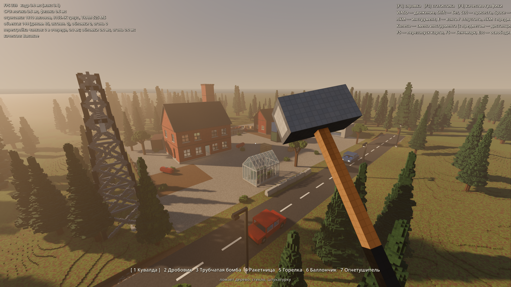
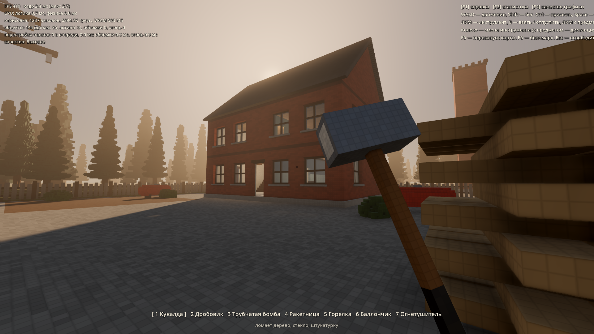
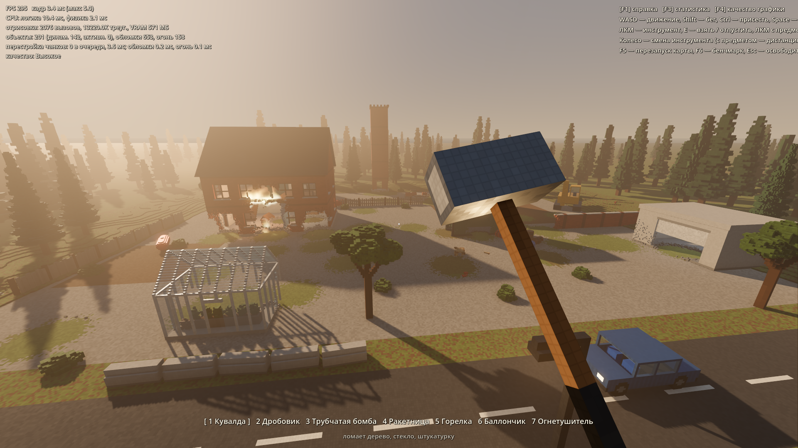
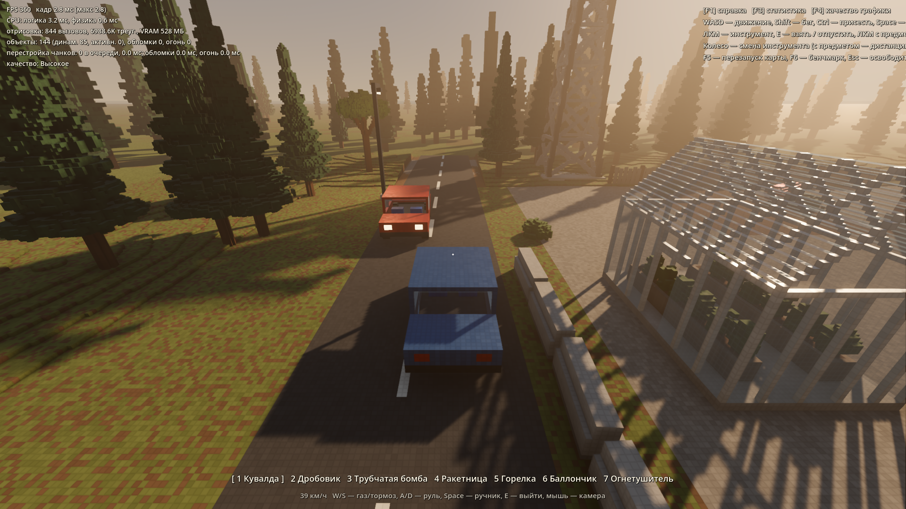
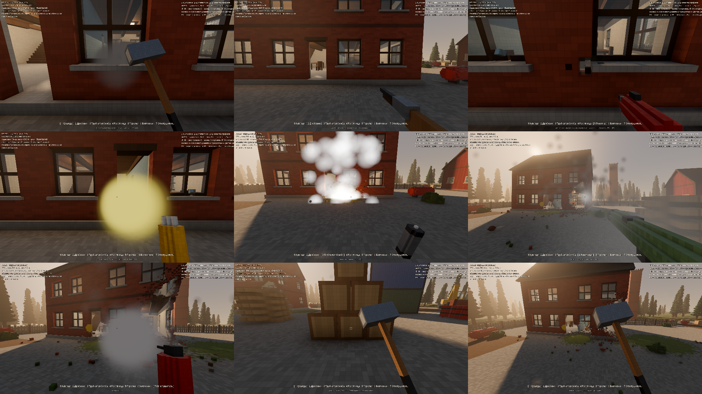

# Voxel Teardown Prototype (Godot 4.7)

## Быстрый старт (Windows)

- **Играть** — дважды кликнуть `play.bat`. В первый раз он сам скачает Godot 4.7.1 (~85 МБ) в папку `.engine\` и подготовит проект, потом запускает сразу.
- В меню: «Американский пригород» (песочница), «Командный бой 5×5 — TDM с ботами», «Полигон», «Кинопролёты».
- **Слабый ПК / встроенная видеокарта** — попробуй `play_light.bat` (облегчённый режим отрисовки Godot «Mobile»), `play_dx12.bat` (DirectX 12 вместо Vulkan) и `play_light_dx12.bat` (оба сразу) и оставь самый быстрый. FPS показывает F3.
- **Открыть в редакторе** — `editor.bat` (в редакторе F5 — запуск игры).
- После `git clone` ничего собирать не нужно: готовое ядро `game/bin/voxcore.dll` лежит в репозитории.
- Пересобирать ядро (`build_native.bat`) нужно только если менялся C++ в `native/src/`.
  Для этого нужны MSVC Build Tools + CMake/Ninja в `C:\BuildTools`, Python и исходники godot-cpp —
  они подключены как git-подмодуль `tools/godot-cpp` (скрипт сам скачает их при первой сборке).


Прототип физической песочницы с полностью разрушаемым воксельным миром в духе Teardown.
Всё на карте — дома, деревья, ЛЭП, машины, ящики, земля — состоит из вокселей 10 см, у каждого
вокселя есть материал с прочностью и плотностью. Объекты ломаются, отрываются куски и падают
под действием физики, горят и бьют друг друга при столкновениях.



| | |
|---|---|
|  |  |
|  |  |

## Запуск

1. Откройте `game/project.godot` в Godot 4.7 (Forward+) и нажмите F5.
   Если редактор был открыт во время пересборки `voxcore.dll` — перезапустите его.
2. Из командной строки:
   ```bash
   Godot_v4.7-stable_win64_console.exe --path game
   ```

Нативное ядро уже собрано (`game/bin/voxcore.dll`). Пересборка — `build_native.bat`
(MSVC Build Tools + CMake/Ninja из `C:\BuildTools`, портативный Python и godot-cpp лежат в `tools/`).
Перед пересборкой закройте запущенную игру: Windows блокирует загруженную DLL.

## Режимы и карта «Американский пригород»

Игра стартует с главного меню: **Американский пригород** (карта 205×205 м, планировка по референсам),
**Полигон** (прототип механик), **Кинопролёты**. Esc в игре — пауза и возврат в меню. Из командной
строки: `-- --level=district|proto`, `--cinematic=all|<шот>`, `--dtour` (тур глазами игрока),
`--audit` (поиск невидимых стен лучами), `--glass` (тест разбивания стекла на бегу).

Карта: пять кирпичных пятиэтажек (walk-up) с пожарными лестницами, кондиционерами в окнах, номерами
домов, подъездами, лестницами и квартирами; супермаркет FOOD MART и аптека PHARMACY с парковками;
автосервис AUTO REPAIR / TIRE SERVICE; ряды складов SELF STORAGE; баскетбольная площадка, детская
площадка со столами для пикника; контейнерная площадка; река с пирсом и лодками; главная дорога с
двойной жёлтой разметкой, знаками STOP, остановками и живым трафиком (школьный автобус, такси,
пикапы, седаны); деревянные столбы ЛЭП, пожарные гидранты, синие почтовые ящики, флаги США,
сетчатый забор и ж/д с цистернами; ~600 деревьев (клёны в осенних цветах, липы, сосны).
Любую машину можно водить (E). Надписи на карте — латиницей (воксельный шрифт 5×7).
Код: `game/scripts/world/district/`.

Новые механики: здоровье (взрывы, падение, огонь, придавливание; регенерация, смерть и
возрождение), звуки по материалу разрушения, гул и пыль при обрушениях, крупные куски
крошат бетон при ударе.

Видео для YouTube: `record_flythrough.bat` — офлайн-рендер кинопролёта (10 шотов, ~110 с, 60 FPS,
со звуком) в `videos/`, затем сжатие в MP4 через ffmpeg.

## Управление

| Клавиша | Действие |
|---|---|
| WASD, Shift, Ctrl/C, Space | ходьба, бег, присесть, прыжок (ступеньки в 1–3 вокселя берутся автоматически) |
| ЛКМ | использовать инструмент |
| 1–7, колесо мыши | выбор инструмента |
| E | взять/отпустить предмет; сесть/выйти из машины |
| ЛКМ с предметом | бросить; колесо — дистанция удержания |
| В машине | W/S газ/тормоз/задний ход, A/D руль, Space ручник, мышь — камера |
| F1 / F3 / F4 | справка / статистика производительности / пресет графики (Низкое…Ультра) |
| F5 / F6 / Esc | перезапуск карты / бенчмарк / освободить курсор |

Инструменты: кувалда, дробовик, трубчатая бомба (3 с), ракетница, горелка (режет металл,
поджигает дерево), баллончик (краска по вокселям), огнетушитель.

## Как устроен Teardown и что взято

Изучено по материалам автора движка Денниса Густафссона и техразборам:

- **Мир — набор воксельных объектов**, каждый со своим объёмом (палитра 256 цветов, воксель 10 см,
  материал задаётся индексом палитры). → Так же: `VoxelVolume` (1 байт/воксель) + общая палитра
  `VoxMat` с таблицей материалов.
- **Материалы с разной прочностью**: кувалда ломает дерево/стекло/штукатурку, кирпич и бетон —
  только взрывчатка, сталь не берёт почти ничего. → Таблица `strength/density` и «мощность»
  инструмента: при `power ≥ strength` удаляется весь радиус, при `power ≥ strength/2` — малое ядро.
- **Структурная целостность**: после разрушения ищутся куски, потерявшие связь с опорой, и
  превращаются в отдельные физические тела. → `split_islands` в C++.
- **Объекты физичны и тяжёлые**: масса и центр масс из вокселей, падение тяжёлого куска ломает
  то, на что он упал. → Урон от импульса контакта (`_integrate_forces`).
- **Огонь** распространяется по дереву и прожигает его; **машины** — обычные разрушаемые объекты.
- Рендер Teardown — трассировка лучей по объёмам. Здесь — меши из жадного мешера с
  per-vertex AO + Godot Forward+ (тени PSSM, SSAO/SSIL, объёмный туман, glow, TAA). Воксельная
  сетка, оттенки каждого вокселя, кирпичная кладка, доски и гофра рисуются шейдером по координате
  вокселя — поэтому стены склеиваются в большие квады.

## Архитектура

```
native/src/                 C++ GDExtension «voxcore» (горячие пути)
  voxel_volume.{h,cpp}      VoxelPalette, VoxelVolume: заливки, разрушение (carve/paint),
                            поиск оторванных островов, масса/центр масс
  voxel_mesher.cpp          жадный мешер с AO + декомпозиция коллизии на боксы
game/scripts/
  voxel/voxel_object.gd     разрушаемое тело: чанки меша, коллизия, урон от ударов
  voxel/voxel_world.gd      конвейер разрушения: взрывы, острова, обломки, очередь перестройки
  voxel/debris_system.gd    пул из 700 мелких обломков (серверные тела + один MultiMesh)
  voxel/vox_mat.gd          палитра, материалы, паттерны шейдера, перекраска/обугливание
  voxel/vox_loader.gd       импорт MagicaVoxel .vox (для построения карт)
  fx/                       частицы, вспышки, огонь, процедурный звук (без ассетов)
  player/                   контроллер игрока, инструменты, снаряды, машина
  world/                    библиотека префабов и тестовая карта, задник (лес, земля)
  core/                     слои физики, пресеты качества, бенчмарк/автотесты
game/shaders/               voxel / стекло / обломки / дальняя земля
```

Ключевые решения по производительности:

- **Чанки 32³** (рельеф 64×32×64): правка перестраивает только затронутые чанки, перестройка идёт
  из очереди с бюджетом 7 мс на кадр. Покраска и обугливание обновляют только меш, без коллизии.
- **Статика — отдельное статическое тело на чанк** (через `PhysicsServer3D`, без нод), динамика —
  составная форма из боксов на `RigidBody3D`. Боксы кэшируются по размеру и переиспользуются.
- **Обход квадратичной сборки форм в Jolt**: Jolt пересобирает составную форму на каждом
  `body_add_shape`, пока тело в пространстве (2000 боксов ≈ 320 мс). Формы добавляются, когда тело
  временно отключено от пространства: 0.9 мс. Это убрало все пики при разрушениях.
- **Листва** получает коллизию на сетке 2× (в 5 раз меньше боксов у деревьев).
- **Поиск островов** с очередью по высоте: поиск сразу идёт вниз к опоре, у целого здания
  проверка после взрыва стоит ~0.1 мс. У свободных тел поиск останавливается, когда набрал
  половину объёма (дальше это заведомо основное тело).
- **Цвет в шейдере, а не в палитре**: в 4–6 раз быстрее мешинг и в разы меньше треугольников.
- Огонь — одна система частиц на все очаги (точки эмиссии из текстуры), обломки — один MultiMesh,
  дальний лес — MultiMesh из упрощённых сосен (воксель 25 см), тени только у ближнего кольца.

## Производительность

RTX 4070 Ti, i5-12400F, 1920×1080, вертикальная синхронизация выключена (`--bench`):

| Фаза | Высокое: ср. FPS / 1% low | Ультра: ср. FPS / 1% low | Кадров > 16.7 мс (Ультра) |
|---|---|---|---|
| Покой | 391 / 360 | 297 / 270 | 0 |
| Снос: 20 взрывов по зданиям | 292 / 120 | 244 / 120 | 0 |
| После сноса (огонь, 700 обломков) | 310 / 270 | 247 / 220 | 0 |
| Стресс: 30 взрывов за 3.6 с | 219 / 90 | 181 / 93 | 0 |
| Оседание (140+ новых тел) | 284 / 270 | 223 / 220 | 0 |

Загрузка карты: ~0.7 с (857 чанков, 21 тыс. коллизионных боксов, 144 объекта).

## Тесты и бенчмарк

```bash
Godot_v4.7-stable_win64_console.exe --path game -- --bench --quit
```

Режимы (после `--`): `--bench` снос и стресс-тест, `--tour` скриншоты с ракурсов и всех
инструментов, `--tools` автотест всех инструментов и захвата, `--drive` автотест вождения,
`--crater` воронка в земле + проверка лучом, что в ней есть коллизия,
`--audit` аудит коллизий: тысячи лучей на высоте игрока по всей карте сверяются с вокселями
и мешами (до и после серии взрывов), `--glass` игрок с разбега пробивает стекло остановки,
`--quality=0..3`, `--shots=<папка>`, `--quit`. Отчёт пишется в `user://bench.txt`.
Тест импорта `.vox` и микробенчмарк нативного ядра:

```bash
Godot_v4.7-stable_win64_console.exe --headless --path game --script res://tests/test_vox.gd
```

```bash
Godot_v4.7-stable_win64_console.exe --headless --path game --script res://tests/perf_native.gd
```

## Следующий этап: воксельная карта

Карту можно строить в MagicaVoxel и загружать `VoxLoader.spawn(world, "res://maps/x.vox", origin)`.
Материал задаётся строкой палитры (как в Teardown): 1–8 стекло, 9–24 листва, 25–40 грунт,
41–56 камень, 57–72 дерево, 73–88 кирпич, 89–104 штукатурка, 105–120 металл, 121–136 сталь,
137–152 пластик, 153–168 бетон, 169–176 светильники, 177–184 неразрушаемое. Модели с именем на
`dyn…` становятся подвижными телами, остальные стоят на земле.

Известные ограничения прототипа: нет здоровья/урона игроку, нет верёвок и сочленений, при
импорте `.vox` игнорируются повороты узлов сцены, палитра общая на 255 цветов.
